# Bézier Surface Renderer

A Windows Forms application that triangulates bicubic Bézier surfaces loaded from a text file and renders
them entirely in software: scan-line triangle filling with a bucket-sorted edge table, per-pixel lighting
(Lambert diffuse + specular), a depth buffer, textures and normal maps. The light travels along an editable
closed Bézier or B-spline curve, and can be switched to three coloured (R, G, B) spotlights.

<p align="center">
  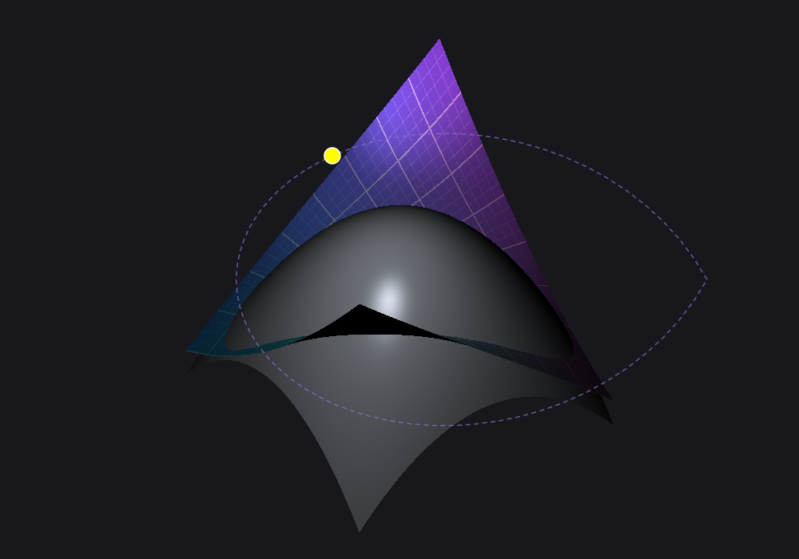
</p>

Full user manual and technical description: [src/BezierSurfaceRenderer.App/Docs/Help.md](src/BezierSurfaceRenderer.App/Docs/Help.md)
— also available inside the application with **F1**.

## Features

- **Bézier surfaces** — any number (≥ 2) of bicubic surfaces read from `Assets/surfaces.txt`, evaluated with
  exact partial derivatives Pu, Pv and normal N = Pu × Pv.
- **Adjustable triangulation** — 1 to 64 cells per side (2·n² triangles per surface).
- **Three display layers**, each togglable: Bézier control nets, triangle mesh wireframe, filled triangles.
- **Software rasterization** — scan-line filling with an edge table (ET) and active edge table (AET),
  top-left fill rule (no gaps or overlaps between neighbouring triangles), Z-buffer.
- **Per-pixel lighting** — barycentric interpolation of z, N, Pu, Pv, u, v; diffuse + specular terms
  with coefficients kd, ks, m; both sides of a surface are lit.
- **Per-surface object colour** — a solid colour or a texture mapped over the (u, v) domain.
- **Per-surface normal maps** — bricks and sphere maps bundled; any image can be loaded.
- **Animated light** on a closed curve in a z = const plane:
  - a degree-8 Bézier curve, or
  - a cubic B-spline built geometrically from 8 Bézier segments (each segment drawn in its own colour);
  - control points can be dragged with the mouse in edit mode.
- **Three lights mode** — red, green and blue lights spaced 1/3 of a lap apart, optionally as Warn
  spotlights (focus exponent p) aimed at the scene centre.
- **Trackball rotation** — unlimited free rotation with a virtual sphere; dragging near the edge spins
  the scene around the viewing axis.
- **Parallel rendering** — horizontal image bands are rendered concurrently.

## Gallery

All images below are produced by the project's own renderer (`BezierSurfaceRenderer.Core`) with the bundled
surfaces, texture and normal maps; the overlays are drawn the same way as in the application's viewport.

### Display layers

| Bézier control nets | Triangle mesh | Filled + mesh |
|:---:|:---:|:---:|
| 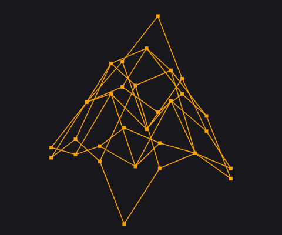 | 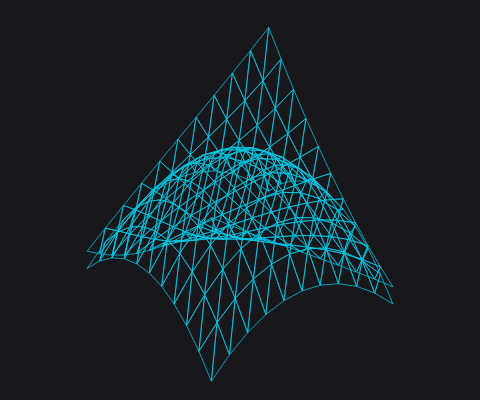 | 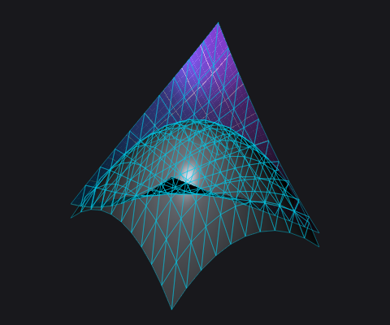 |

### Triangulation density

| n = 2 (8 triangles / surface) | n = 6 (72) | n = 24 (1152) |
|:---:|:---:|:---:|
| 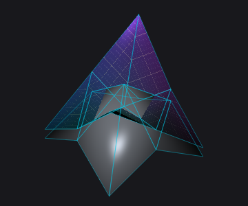 | 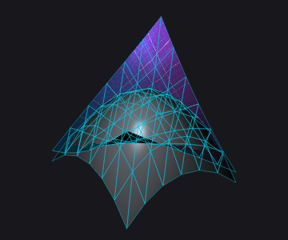 | 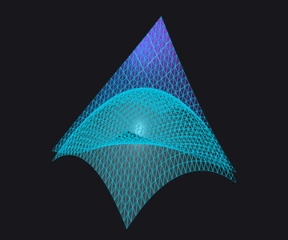 |

### Normal maps

| Normal maps off | Normal maps on (bricks on the dome, sphere on the saddle) |
|:---:|:---:|
| 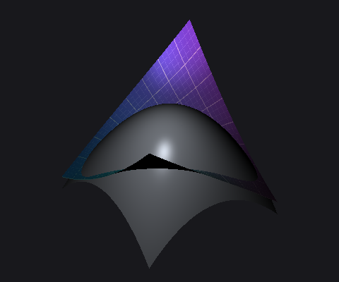 | 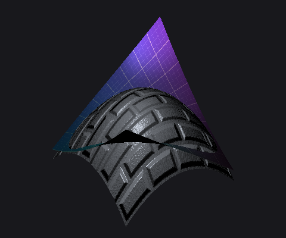 |

### Material

| Matte — kd = 0.9, ks = 0 | Glossy — kd = 0.4, ks = 0.8, m = 60 |
|:---:|:---:|
| 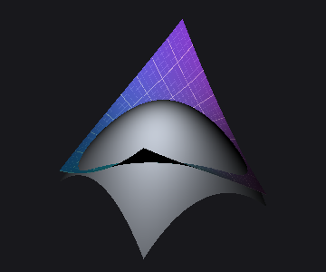 | 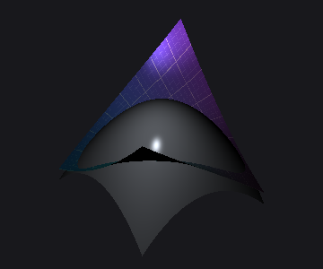 |

### Light path editing

| Degree-8 Bézier curve | Cubic B-spline from 8 Bézier segments |
|:---:|:---:|
| 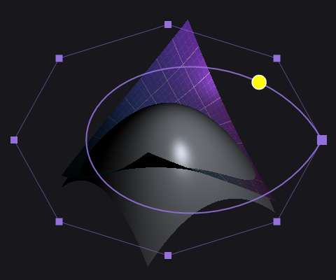 | 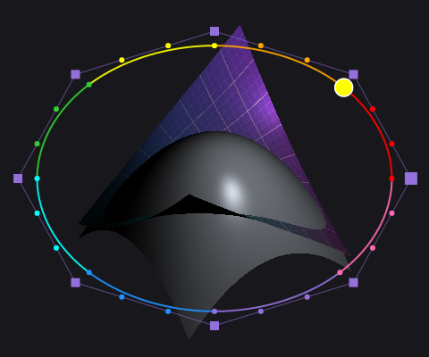 |

The squares are the draggable points V0 … V7 (V0 is the larger one); in B-spline mode the small dots are
the Bézier control points of each segment, built from the polygon's edge thirds and their midpoints.

### Three R, G, B lights

| Point lights | Spotlights aimed at the centre (p = 12) |
|:---:|:---:|
| 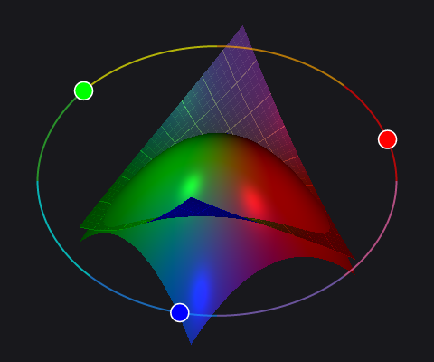 | 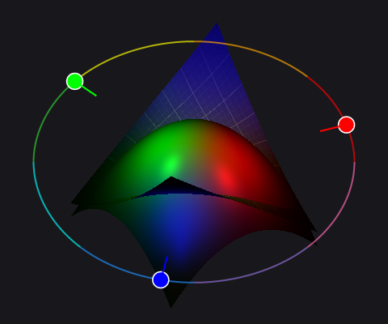 |

### Rotation

| Start view | + rotation about y | + rotation about x |
|:---:|:---:|:---:|
| 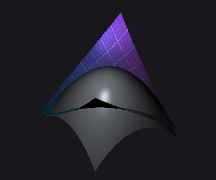 | 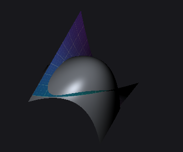 | 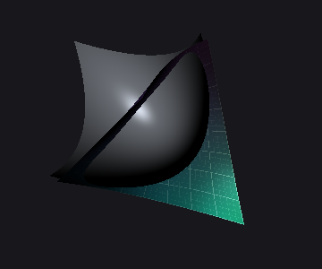 |

## Requirements

- Windows 10 or 11
- [.NET 8 SDK](https://dotnet.microsoft.com/download/dotnet/8.0)
- Optional: Visual Studio 2022 17.8 or newer

The core library and the tests target plain `net8.0` and run on any OS (Windows, macOS, Linux);
only the WinForms application needs Windows.

## Build and run

From the repository root:

```
dotnet run --project src/BezierSurfaceRenderer.App
```

or open `BezierSurfaceRenderer.sln` in Visual Studio, set `BezierSurfaceRenderer.App` as the startup project
and press F5.

For a release build:

```
dotnet build -c Release
```

## Tests

The UI-independent core (math, filling, lighting, rendering, file parsing, light path) is covered by xUnit tests:

```
dotnet test
```

| Test file | What it checks |
|---|---|
| `BezierSurfaceTests.cs` | Bernstein basis, corner interpolation, tangents vs. finite differences, normals |
| `FillerTests.cs` | Edge-table filling, shared edges without gaps or overdraw, degenerate triangles, clipping, concave polygons |
| `LightPathTests.cs` | Bézier and B-spline light paths, C1 joints, animation, hit testing, three-light offsets, spotlight direction |
| `Mat3Tests.cs` | Rx/Ry/Rz, matrix product order, axis-angle (Rodrigues) rotation, orthonormalization after drift |
| `SceneTests.cs` | Triangulation, incremental rotation, unbounded rotation, trackball behaviour, bounding radius |
| `ShadingTests.cs` | Lighting model, multiple lights, spotlights, normal mapping, texture sampling, Z-buffer |
| `SurfaceFileTests.cs` | Input file parsing and error messages, bundled surfaces |

## Usage

### Mouse

| Action | Effect |
|---|---|
| Left-button drag | Free rotation — the point under the cursor follows the cursor |
| Drag near the edge / outside the virtual sphere | Rotation about the viewing (z) axis |
| Drag a light path point | Moves the control point (only in "Edit light path" mode) |

### Keyboard

| Key | Action |
|---|---|
| F1 | Open the documentation |
| Space | Start / stop the light animation |
| E | Toggle light path editing |
| R | Reset the scene orientation |
| 1 / 2 / 3 | Toggle control nets / triangle mesh / filled triangles |
| Arrows, PgUp/PgDn, Home/End, mouse wheel | Change the focused slider |

### Control panel

- **Geometry** — triangulation density and the three display layers.
- **Material** — kd, ks (0–1) and m (1–100), shared by all surfaces.
- **Surface** — pick a surface, then set its solid colour or texture and its normal map.
- **Light** — z of the light plane, light colour, animation, path editing, Bézier / B-spline path,
  three R, G, B lights and spotlight focus p.

The menu **Colors** also lets you choose the object and light colours.

## Input file format

`src/BezierSurfaceRenderer.App/Assets/surfaces.txt` is copied next to the executable and loaded at startup.
Each surface is 16 lines `x y z` (dot as decimal separator) in the order V00, V01, V02, V03, V10, …, V33 —
line k holds V(i, j) with i = k / 4 (parameter u) and j = k mod 4 (parameter v). Surfaces follow one
another; at least two are required, blank lines are ignored.

```
-1.0000 -1.0000 -1.0000
-1.0000 -0.3333 -0.2000
-1.0000  0.3333 -0.2000
...
```

The bundled file contains a "dome" and a wavy "saddle" whose control points fill the cube [−1, 1]³.
Malformed files produce an error message naming the offending line.

## How it works

### Rendering pipeline

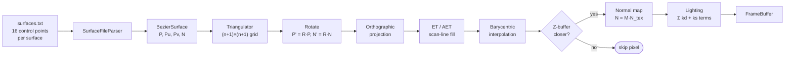

### One frame in the application

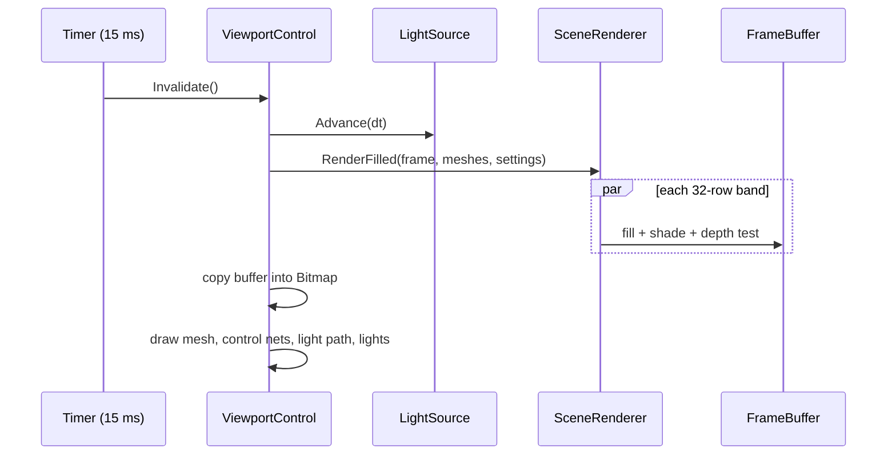

### Mouse rotation (virtual sphere)

<p align="center">
  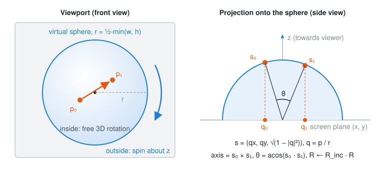
</p>

### Step by step

1. **Evaluation** — P(u, v) = Σ Σ V(i,j)·B(i,3)(u)·B(j,3)(v) with Bernstein polynomials; Pu, Pv from
   degree-2 Bernstein forms; N = normalize(Pu × Pv).
2. **Triangulation** — a regular (n+1)×(n+1) grid in (u, v), two triangles per cell.
3. **Rotation** — a single orientation matrix R, updated on every mouse move by
   R ← orthonormalize(R_inc · R), where R_inc is the shortest rotation between the two cursor positions
   projected onto a virtual sphere (Rodrigues' formula).
4. **Projection** — orthographic onto the xy plane, scaled so the bounding sphere of all control points fits.
5. **Filling** — ET/AET scan-line algorithm per triangle, sampling pixel centres with the top-left rule.
6. **Shading** — per pixel: barycentric interpolation, optional normal map (N = M · N_tex with
   M = [Pu, Pv, N]), then

   ```
   I = kd·IL·IO·cos(N, L) + ks·IL·IO·cos^m(V, R),   V = [0, 0, 1],  R = 2⟨N, L⟩N − L
   ```

   summed over all lights; spotlights scale IL by cos^p(α).
7. **Depth test** — Z-buffer, the viewer looks from +z.

See [Help.md](src/BezierSurfaceRenderer.App/Docs/Help.md) for the full derivation, a worked trackball example,
and the geometric B-spline construction.

## Project structure

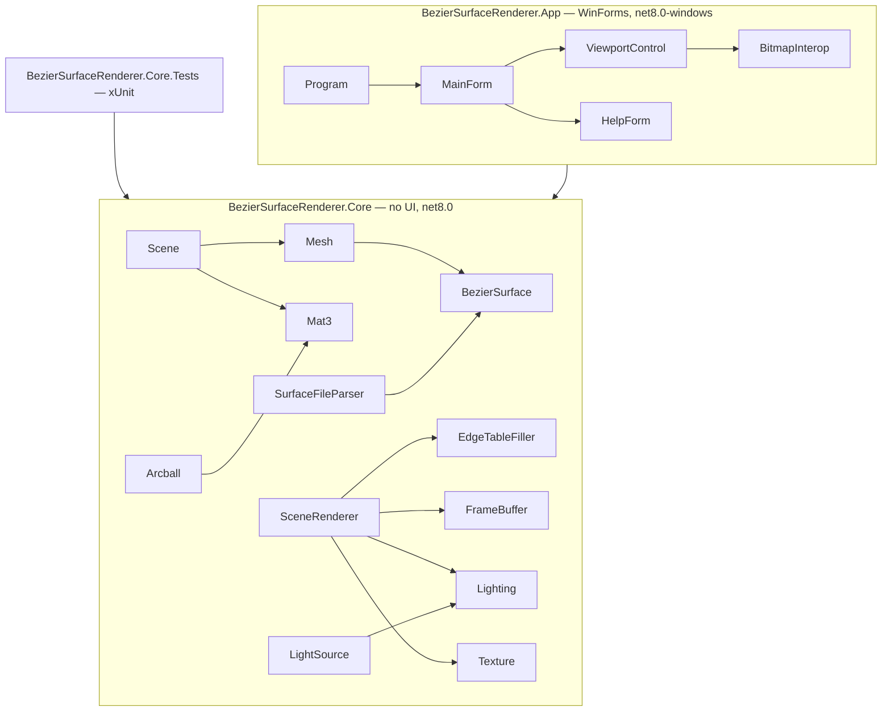

```
BezierSurfaceRenderer.sln
src/
  BezierSurfaceRenderer.Core/      UI-independent library (net8.0)
    BezierSurface.cs               Surface evaluation (point, Pu, Pv, N)
    Mesh.cs                        Triangulation into vertices/triangles
    Mat3.cs                        3×3 matrices, Rx/Ry/Rz, Rodrigues, orthonormalization
    Arcball.cs                     Virtual sphere mouse → rotation mapping
    Scene.cs                       Surfaces, their meshes and the accumulated orientation
    EdgeTableFiller.cs             ET/AET scan-line triangle filling
    FrameBuffer.cs                 Colour buffer + Z-buffer
    Lighting.cs                    Light (point / spot) and the lighting model
    LightSource.cs                 Bézier / B-spline light path
    Texture.cs                     Texture sampling and normal map decoding
    SceneRenderer.cs               Full render pass (parallel bands)
    SurfaceFileParser.cs           Input file reader with validation
  BezierSurfaceRenderer.App/       WinForms application (net8.0-windows)
    Program.cs                     Entry point, loads surfaces.txt
    MainForm.cs                    Control panel, menus, shortcuts, animation
    ViewportControl.cs             Drawing area, mouse handling, overlays
    BitmapInterop.cs               Image ↔ buffer conversion
    HelpForm.cs                    F1 help window (Markdown via Markdig)
    Docs/Help.md                   User manual and technical description
    Assets/                        surfaces.txt, default texture, normal maps
tests/
  BezierSurfaceRenderer.Core.Tests/  xUnit tests for the core library
docs/images/                       README images and diagrams
```

## Dependencies

- [Markdig](https://github.com/xoofx/markdig) — renders the help page from Markdown.
- xUnit, Microsoft.NET.Test.Sdk, coverlet — tests only.
